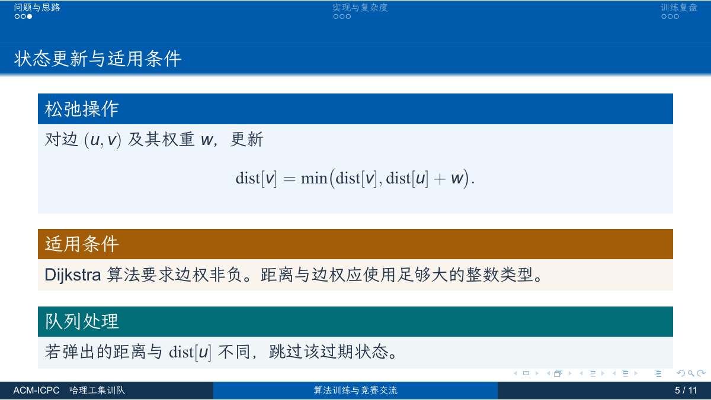
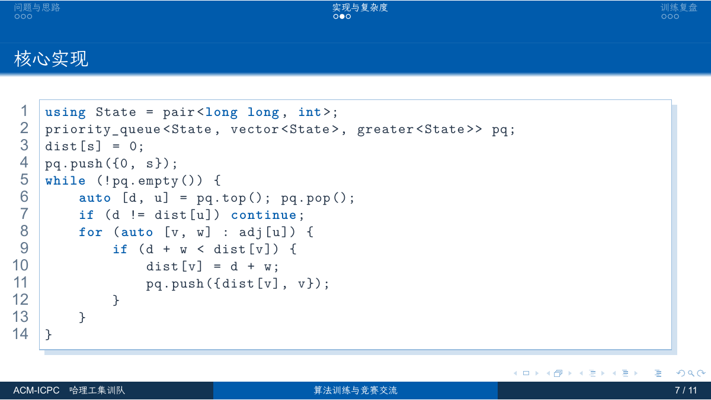

# 哈尔滨理工大学 ACM-ICPC 集训队 Beamer 主题

[](https://github.com/ryx1447368303-spec/HRBUST-ACM-ICPC-Beamer-Theme/actions/workflows/online_compile.yml)
[](https://github.com/ryx1447368303-spec/HRBUST-ACM-ICPC-Beamer-Theme/releases/latest)
[](LICENSE)

[](https://www.overleaf.com/docs?snip_uri=https://github.com/ryx1447368303-spec/HRBUST-ACM-ICPC-Beamer-Theme/releases/latest/download/HRBUST-ACM-ICPC-Theme-overleaf.zip&main_document=slide.tex)

基于 [ShinoharaHaruna/SDU-Beamer-Theme](https://github.com/ShinoharaHaruna/SDU-Beamer-Theme) 的经典 `main` 分支定制。
保留原版的 16:9 页面、smoothbars 顶部导航、圆点进度、自动章节目录、三段页脚和代码框样式，替换校徽、队名与配色。

[English](README_EN.md)

## 下载与在线使用

- [最新发布](https://github.com/ryx1447368303-spec/HRBUST-ACM-ICPC-Beamer-Theme/releases/latest)：下载已编译 PDF 与源码包。
- [完整源码包](https://github.com/ryx1447368303-spec/HRBUST-ACM-ICPC-Beamer-Theme/releases/latest/download/HRBUST-ACM-ICPC-Theme.zip)：包含原模板字体、完整指南和起步示例，适合保留原有字体风格。
- [Overleaf 精简包](https://github.com/ryx1447368303-spec/HRBUST-ACM-ICPC-Beamer-Theme/releases/latest/download/HRBUST-ACM-ICPC-Theme-overleaf.zip)：使用 Fandol 字体，无须 biber。上传后选择 **XeLaTeX**。
- [起步示例 PDF](template.pdf) · [完整排版指南 PDF](slide.pdf)

## 预览






- `template.pdf`：可以直接用于算法讲解、训练总结的起步示例。
- `slide.pdf`：完整排版指南，包含列表、公式、定理、表格、插图、代码与参考文献。

## 快速开始

下载发布包，或克隆仓库：

```bash
git clone https://github.com/ryx1447368303-spec/HRBUST-ACM-ICPC-Beamer-Theme.git
cd HRBUST-ACM-ICPC-Beamer-Theme
```

1. 编辑 `template.tex`，修改标题、汇报人、日期和正文。
2. 使用 **XeLaTeX** 编译。仓库字体由文件路径加载，无须手动安装。
3. 有 TeX Live / MiKTeX 的环境下，在项目目录运行：

```powershell
latexmk template.tex
```

Windows PowerShell 7 也可以运行以下脚本，同时编译起步模板与完整指南：

```powershell
.\build.ps1
```

仅编译起步模板：

```powershell
.\build.ps1 -Document template
```

手动编译起步模板需要两遍，以收敛目录和页码：

```powershell
xelatex template.tex
xelatex template.tex
```

完整指南使用 `biblatex` / `biber`，运行 `latexmk slide.tex` 会自动处理。

## 文档信息

```latex
\documentclass[aspectratio=169]{beamer}
\input{fonts-setup.tex}
\usetheme{HRBUST}

\title[算法训练与竞赛交流]{哈尔滨理工大学 ACM-ICPC 集训队}
\subtitle{本次训练主题}
\author[汇报人简称]{汇报人姓名}
\institute[哈理工集训队]{哈尔滨理工大学 ACM-ICPC 集训队}
\date{\today}
```

方括号中的简称用于页脚，长名称用于封面。保持页脚简称简洁即可避免挤占空间。
封面在 `\titlepage` 后使用 `\hrbustlogo`，也可以通过 `\hrbustlogo[1.5cm]` 设置宽度，校徽比例始终保留。
原来的 `\usetheme{SDU}`、`\usepackage{SDU}` 与 `peaking` 颜色名仍兼容。

## 配色

所有主题颜色集中在 `beamercolorthemeHRBUST.sty`。

| 用途 | 色值 | 颜色名 |
| --- | --- | --- |
| 校方科技蓝，标题、导航、普通内容块 | `#005BAC` | `hrbustblue` |
| 深海军蓝，页脚两翼与链接 | `#123352` | `hrbustnavy` |
| 正文 | `#243448` | `hrbustink` |
| 次要文字与代码注释 | `#61768C` | `hrbustmuted` |
| 示例与代码字符串 | `#006D77` | `hrbustteal` |
| 注意事项与强调 | `#A35D08` | `hrbustamber` |
| 普通内容块的浅蓝底色 | `#EEF5FC` | `hrbustpale` |

校徽使用学校官网原图，来源与标准色依据见 [校徽说明](img/branding/README.md)。

## 字体

`fonts-setup.tex` 直接读取仓库中的 LXGW WenKai 与 Sarasa Mono SC，保留原模板的字体风格。
英文优先使用 Times New Roman / Arial，缺失时回退至 TeX Gyre Termes / Heros。
移除 `fonts/` 后会自动使用 TeX Live / Overleaf 自带的 Fandol 中文字体。
字体文件遵循其各自许可证，见 `fonts/OFL.txt`。

## Overleaf 打包

生成精简起步包，使用 Fandol 字体、无需 biber：

```powershell
.\pack-overleaf.ps1
```

默认输出 `dist/HRBUST-ACM-ICPC-Theme-overleaf.zip`。上传后设置：

- Main document：`slide.tex`
- Compiler：**XeLaTeX**

打包时起步模板会命名为 `slide.tex`，原始 `template.tex` 也一并保留。

需要保留原字体时：

```powershell
.\pack-overleaf.ps1 -WithFonts -Output dist/HRBUST-ACM-ICPC-Theme-with-fonts.zip
```

需要完整排版指南、插图与参考文献时使用 `-Full`。带字体或完整指南的包体积更大，编译耗时也更长。
Python / Linux / macOS 可运行 `python3 pack_overleaf.py`，或 `./pack_overleaf.sh`。
本定制版以 XeLaTeX 为统一编译方式。

包含已编译 PDF 的完整发布包：

```powershell
python pack_overleaf.py --full --with-fonts --include-pdfs -o dist/HRBUST-ACM-ICPC-Theme.zip
```

## GitHub Actions

- 推送到 `main`、提交 Pull Request 或手动运行时，自动编译两份示例并检查版面警告。生成的 PDF 可从 Actions 页下载。
- 发布 Release 时，自动重新编译，上传两份 PDF、完整源码包与 Overleaf 精简包。
- 自动构建使用 TeX Live 2026，直接读取仓库字体。构建结果保存在 artifacts 和 Release 附件中。

## 反馈与贡献

编译问题、版面问题或改进建议，请提交到[本仓库 Issues](https://github.com/ryx1447368303-spec/HRBUST-ACM-ICPC-Beamer-Theme/issues)。
报告问题时请附编译引擎、错误信息及最小示例。提交修改前请阅读 [贡献说明](CONTRIBUTING.md)。
版本变化见 [更新记录](CHANGELOG.md)。

## 项目结构

| 文件 | 用途 |
| --- | --- |
| `template.tex` | 集训队汇报起步模板 |
| `slide.tex` / `ref.bib` | 完整排版指南与参考文献 |
| `beamerthemeHRBUST.sty` | 主题布局、页脚、代码框与校徽命令 |
| `beamercolorthemeHRBUST.sty` | 统一配色 |
| `fonts-setup.tex` | 字体加载与回退 |
| `img/branding/` | 校徽原图与来源 |
| `build.ps1` | PowerShell 7 编译入口 |
| `pack-overleaf.ps1` / `pack_overleaf.py` | Overleaf 打包入口 |
| `SDU.sty` / `beamerthemeSDU.sty` / `beamercolorthemeSDU.sty` | 原主题调用兼容层 |

## 致谢与许可

本定制版基于 [ShinoharaHaruna/SDU-Beamer-Theme](https://github.com/ShinoharaHaruna/SDU-Beamer-Theme)，
保留上游 [MIT 许可证](LICENSE)。主题谱系包含 Ura 的 SDU 主题、
[PKU-Beamer-Theme](https://github.com/inFaaa/PKU-Beamer-Theme) 与
[THU-Beamer-Theme](https://github.com/tuna/THU-Beamer-Theme)。
校徽权利归哈尔滨理工大学所有，本模板为集训队使用场景的定制版本。
