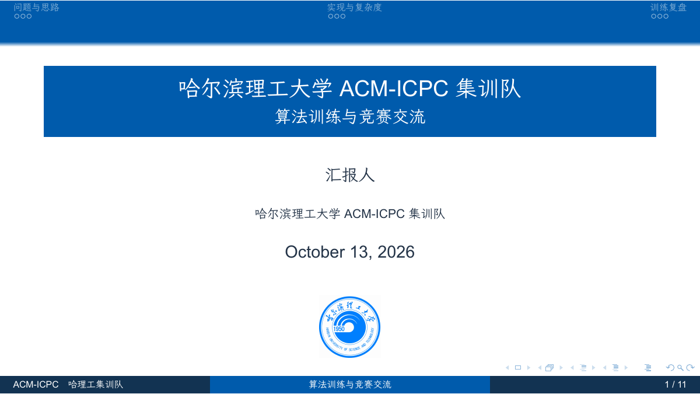

# HRBUST ACM-ICPC Beamer Theme

[](https://github.com/ryx1447368303-spec/HRBUST-ACM-ICPC-Beamer-Theme/actions/workflows/online_compile.yml)
[](https://github.com/ryx1447368303-spec/HRBUST-ACM-ICPC-Beamer-Theme/releases/latest)
[](LICENSE)

A customization of the classic main branch of
[ShinoharaHaruna/SDU-Beamer-Theme](https://github.com/ShinoharaHaruna/SDU-Beamer-Theme)
for the ACM-ICPC training team at Harbin University of Science and Technology.

The original 16:9 layout, smoothbars navigation, progress dots, section outlines,
three-part footer and code frames are retained. University/team branding and the
palette are updated. The primary color is the university blue, RGB(0, 91, 172).
Official emblem files and source links are in `img/branding/`.

## Download

- [Latest release](https://github.com/ryx1447368303-spec/HRBUST-ACM-ICPC-Beamer-Theme/releases/latest): PDFs and ready-to-use packages.
- [Full source package](https://github.com/ryx1447368303-spec/HRBUST-ACM-ICPC-Beamer-Theme/releases/latest/download/HRBUST-ACM-ICPC-Theme.zip): original fonts, both editable examples and compiled PDFs.
- [Compact Overleaf package](https://github.com/ryx1447368303-spec/HRBUST-ACM-ICPC-Beamer-Theme/releases/latest/download/HRBUST-ACM-ICPC-Theme-overleaf.zip): Fandol fonts, no biber. Select **XeLaTeX** after uploading.
- [Starter PDF](template.pdf) / [Full formatting guide](slide.pdf)



## Use

```bash
git clone https://github.com/ryx1447368303-spec/HRBUST-ACM-ICPC-Beamer-Theme.git
cd HRBUST-ACM-ICPC-Beamer-Theme
```

Edit `template.tex` and compile with XeLaTeX:

```text
latexmk template.tex
```

On Windows with PowerShell 7, `./build.ps1` builds both the starter and the full
formatting guide. `./build.ps1 -Document template` builds only the starter.
The full guide, `slide.tex`, uses biblatex/biber.

Use `\usetheme{HRBUST}` in new documents. The old SDU entry points and `peaking`
color name remain compatible. The cover uses `\hrbustlogo`, optionally with a
width such as `\hrbustlogo[1.5cm]`.

`fonts-setup.tex` loads the bundled WenKai and Sarasa fonts directly from files.
When `fonts/` is absent it falls back to TeX Live's Fandol fonts. Latin fonts use
Times New Roman / Arial when available, otherwise TeX Gyre Termes / Heros.

## Overleaf

```text
python3 pack_overleaf.py
```

Or use `./pack-overleaf.ps1` on Windows. The default output is
`dist/HRBUST-ACM-ICPC-Theme-overleaf.zip`. Set the main document to `slide.tex`
and the compiler to **XeLaTeX** after uploading. The starter requires no biber.

Options: `--full` includes the full guide and references; `--with-fonts` includes
the original font files. `-o FILE.zip` selects the output. PowerShell equivalents
are `-Full`, `-WithFonts` and `-Output`.

Add `--include-pdfs` to include compiled PDFs in a full release package.
GitHub Actions builds both documents with TeX Live 2026 on pushes, pull requests
and manual runs. Publishing a release also builds and uploads the PDFs and zip packages.

## Contributing

Report bugs and suggestions in [this repository's Issues](https://github.com/ryx1447368303-spec/HRBUST-ACM-ICPC-Beamer-Theme/issues).
Include your compiler version, relevant error message and a minimal example.
See [CONTRIBUTING.md](CONTRIBUTING.md) and [CHANGELOG.md](CHANGELOG.md).

## Palette and credits

Colors are centralized in `beamercolorthemeHRBUST.sty`: university blue `#005BAC`,
navy `#123352`, body text `#243448`, muted text `#61768C`, teal `#006D77`,
amber `#A35D08` and a pale blue block background `#EEF5FC`.

The upstream MIT license is retained in `LICENSE`. Credits also go to Ura,
PKU-Beamer-Theme and THU-Beamer-Theme. The university owns its emblem.
See [the Chinese guide](README.md) for full instructions and previews.
